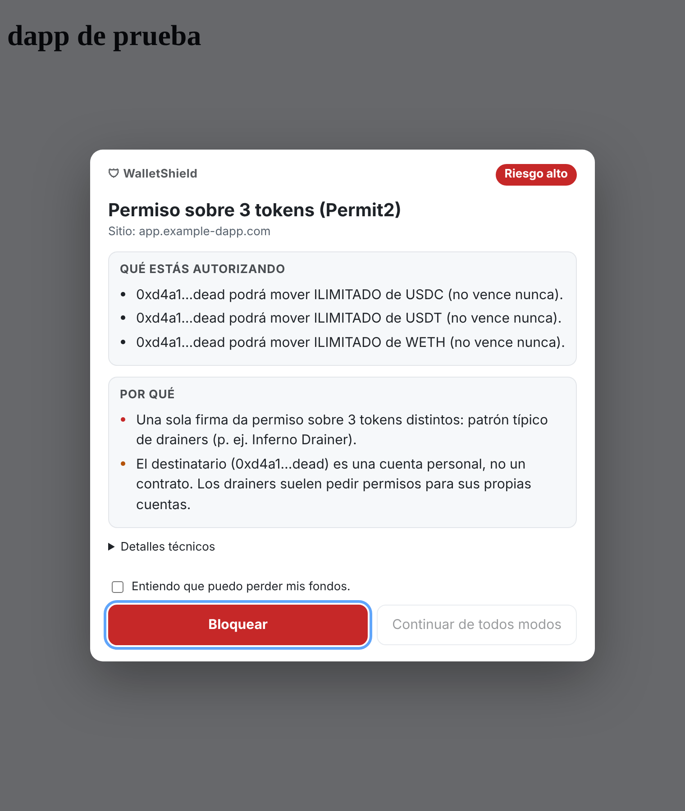
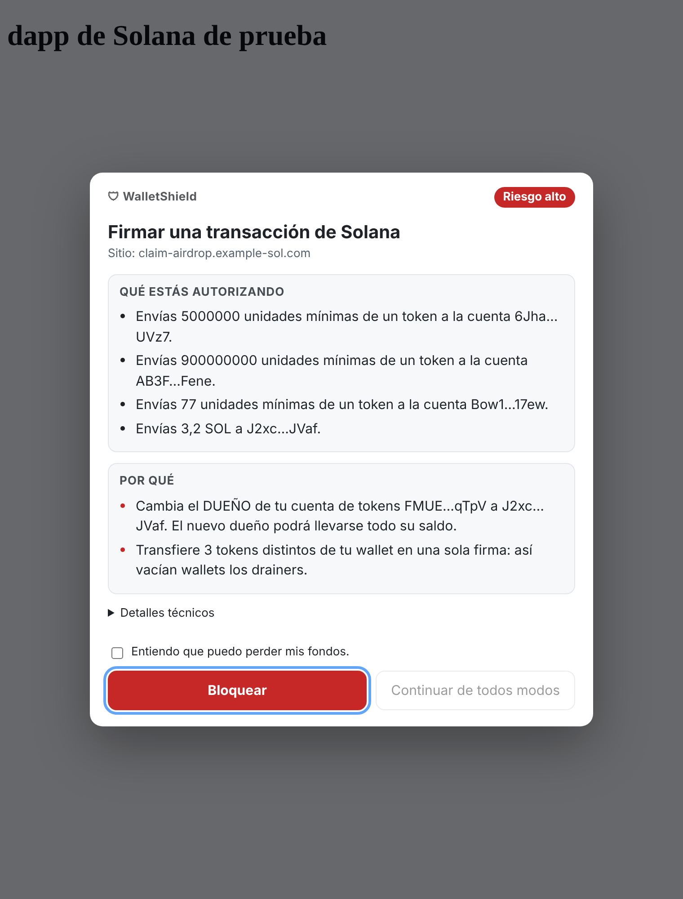
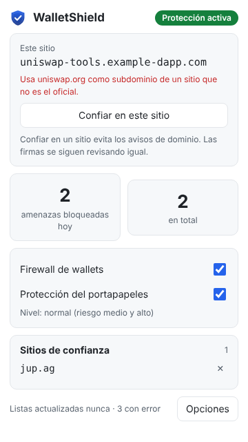

# WalletShield

Extensión de Chrome (Manifest V3) que protege contra phishing y drainers dirigidos a wallets cripto (MetaMask, Rabby y, opcionalmente, Phantom). Todo el análisis es local: **cero telemetría**. Lo único que sale del navegador es la descarga de las listas públicas de phishing.

> **Estado: fase 6 de 8.** La extensión está completa: bloqueo de phishing, detección de imitaciones, firewall EVM y Solana, detección de scripts maliciosos y clipboard hijacking, popup y página de opciones. Faltan el monitor en la nube y la auditoría final.

| Fase | Contenido | Estado |
|---|---|---|
| 1 | Arquitectura y plan | ✅ |
| 2 | Bloqueo por dominio (declarativeNetRequest) + heurísticas | ✅ |
| 3 | Firewall de wallets EVM (proxy del provider, decodificador, modal) | ✅ |
| 4 | Scripts maliciosos y clipboard hijacking | ✅ |
| 5 | Solana / Phantom | ✅ |
| 6 | Popup y página de opciones | ✅ |
| 7 | Monitor en la nube (Ethereum + Arbitrum) con alertas de Telegram | ⏳ |
| 8 | Medición de rendimiento y auditoría de seguridad | ⏳ |

## Instalación en modo desarrollador

Requisitos: Node 20 o superior y Chrome 121 o superior.

```bash
npm ci
```

```bash
npm run build
```

1. Abre `chrome://extensions`.
2. Activa **Modo de desarrollador** (arriba a la derecha).
3. Haz clic en **Cargar descomprimida** y elige la carpeta `dist/`.

Al instalarse, la extensión ya protege con el snapshot de listas empaquetado. En segundo plano descarga las listas actualizadas (unos 14 MB la primera vez, una sola vez).

## Cómo funciona (fase 2)

```
Navegación ──► Motor DNR de Chrome (nativo, sin JS)
                 ├─ dominio en lista ──► redirige a blocked.html
                 ├─ script/iframe/xhr desde dominio en lista ──► bloqueado
                 └─ página en Google Sites listada ──► blocked.html (regla por ruta)
          └──► webNavigation.onBeforeNavigate (service worker)
                 └─ heurísticas: homoglifos, punycode, typosquatting,
                    "marca + claim/airdrop", marca en subdominio ajeno
                    └─ riesgo alto ──► blocked.html?src=h
                       riesgo medio ──► insignia "!" en el ícono
```

### Listas en reglas nativas (declarativeNetRequest)

- El filtrado lo hace el motor de Chrome, no JavaScript. Los ~500.000 dominios **no viven en la memoria de la extensión**. Por eso no hace falta un Bloom filter: la búsqueda O(1) la resuelve Chrome con sus índices.
- Cada fuente reparte sus dominios en *buckets* por hash (FNV‑1a). Cada bucket genera dos reglas: `redirect` para la navegación y `block` para scripts, iframes, XHR y websockets.
- **Snapshot estático:** MetaMask y polkadot vienen empaquetados (`rules/static/`). No hay costo al arrancar.
- **Actualización (alarma cada 6 h):**
  - descarga condicional con `ETag` / `If-Modified-Since`: si no hubo cambios, responde 304 y no se baja nada;
  - si cambió, se calcula el diff por bucket y solo se reescriben los buckets afectados;
  - si un dominio salió de la lista, se deshabilita la regla estática de su bucket (`updateStaticRules`) y una regla dinámica la reemplaza sin ese dominio.
- **ScamSniffer (incremental real):** se leen los archivos diarios `archive/AAAA-MM-DD.json`, que solo traen las altas. La lista completa se descarga una vez por semana para captar las bajas.
- **Protección contra listas rotas:** si una descarga trae menos de la mitad de los dominios que había, se ignora.

### Heurísticas (`shared/domain/`)

| Señal | Ejemplo | Riesgo |
|---|---|---|
| Homoglifos (mismo "esqueleto" visual) | `uniswаp.org` (a cirílica), `0pensea.io`, `metarnask.io` | alto |
| Mezcla de alfabetos en una etiqueta | latín + cirílico | alto |
| Typosquatting (Damerau‑Levenshtein acotado) | `uinswap.org`, `openseoa.app` | alto (marcas ≥7 letras) / medio |
| Marca + palabra gancho | `uniswap-claim.com`, `raydium-airdrop.xyz` | alto |
| Dominio legítimo dentro del subdominio | `app.uniswap.org.secure-login.xyz` | alto |
| Misma marca, otra extensión | `opensea.support`, `uniswap.app` | medio |
| Dominio recién registrado (RDAP, **opcional**) | menos de 30 días | sube de medio a alto |

**Falsos positivos medidos:** sobre el top‑10.000 de dominios más visitados hubo **0 de riesgo alto** y 2 de riesgo medio (`zapier.com` y `rabb.it`, que solo muestran la insignia). El análisis tarda unos 40 µs por dominio. Para repetir la medición:

```bash
npm run eval:heuristics -- top-10000-domains.txt config.json
```

Nivel de estricteza: **relajado** y **normal** muestran la página de bloqueo solo con riesgo alto; **estricto** también con riesgo medio.

## Firewall de wallets (fase 3)



```
Página ──request()──► Proxy de WalletShield (world MAIN, document_start)
                         │ método de lectura (eth_call, eth_chainId…) ──► wallet (≈2 µs extra)
                         │ firma o transacción
                         ▼  canal privado (MessagePort)
                      Script aislado: decodifica y analiza localmente
                         │ consultas de solo lectura vía la wallet (eth_getCode, saldo, decimals)
                         ├─ riesgo bajo ──► wallet
                         └─ riesgo medio/alto ──► modal (Shadow DOM cerrado, top layer)
                                                   "Bloquear" (por defecto) / "Continuar"
```

**Qué se intercepta:** `window.ethereum`, los providers anunciados por EIP-6963, `request`, `send`, `sendAsync` y cualquier otro método del provider que reciba un payload JSON-RPC (por ejemplo, el interno `_rpcRequest`). También se protege el provider que devuelven métodos como `.on()`, y el `window.ethereum` que una wallet define con `Object.defineProperty`.

**Qué se analiza** (todo local, sin enviar datos a terceros):

| Solicitud | Qué detecta | Riesgo típico |
|---|---|---|
| `eth_sign` | Firma ciega | Alto. En modo estricto se bloquea sin opción de continuar |
| `personal_sign` | Hash de 32 bytes (firma ciega); SIWE para otro dominio; texto | Alto / alto / bajo |
| `approve`, `increaseAllowance`, `permit` on-chain | Monto ilimitado; destinatario cuenta personal, contrato desconocido u oficial | Alto, salvo contratos oficiales (medio) |
| `setApprovalForAll` | Acceso a toda la colección | Alto (marketplace oficial: medio) |
| Permit (EIP-2612 y DAI) | A quién, cuánto y hasta cuándo, en lenguaje claro | Según destinatario, monto y vencimiento |
| Permit2 (`PermitSingle`, `PermitBatch`, `PermitTransferFrom`, witness) | Lotes de tokens (patrón Inferno), retiros inmediatos, "Permit2" falso | Alto con destinatario desconocido |
| Seaport (OpenSea), incl. `BulkOrder` | Venta de tus NFTs por 0 o casi 0; contrato falso | Alto |
| Blur | `Root` (firma ciega de órdenes); venta a precio 0 | Alto |
| Transacciones con ETH | ≥ 90 % del saldo; funciones de drainer (`Claim()`, `SecurityUpdate()`…) | Alto con destino desconocido |
| `multicall`, `wallet_sendCalls` (EIP-5792) | Se decodifica cada llamada interna | Según el contenido |
| EIP-7702 (`authorizationList`) | Delegar tu cuenta a un contrato | Alto |
| Cualquier firma en un sitio con dominio sospechoso | Combinación con las heurísticas de la fase 2 | Alto |
| Solicitud desde un iframe diminuto u oculto | Patrón de drainers | Bloqueo automático |

**Sin falsos positivos en flujos comunes:** el swap con Permit2 de Uniswap (firma al Universal Router con vencimiento de 30 días), UniswapX, listings normales de OpenSea, órdenes de CoW, permits a 1inch y logins SIWE del mismo sitio pasan sin modal. La única advertencia frecuente aparece la primera vez que apruebas un token a Permit2: es ilimitada, así que se avisa con riesgo medio aunque Permit2 sea un contrato oficial.

**Cuándo aparece el modal:** en modo relajado solo con riesgo alto; en modo normal desde riesgo medio; en modo estricto desde riesgo bajo.

**Contratos conocidos:** 64 direcciones en Ethereum y Arbitrum (`shared/evm/known.ts`). Las de Permit2, Uniswap Universal Router, UniswapX, Seaport y CoW se copiaron de la documentación oficial de cada proyecto. Todas se verifican con el checksum EIP-55 en los tests. Que un contrato sea conocido baja el riesgo, pero nunca lo anula.

**Robustez del modal:**
- Shadow DOM cerrado y `<dialog>` en la top layer: la página no puede leer el modal, taparlo ni modificarlo.
- Solo acepta clics reales (`isTrusted`) que caen sobre el propio modal.
- "Continuar" con riesgo alto exige marcar una casilla y esperar 1,5 s.
- Enter y Escape bloquean.
- Si la página borra el modal, la solicitud se bloquea.

**Latencia medida** (`npm run e2e:firewall`, Chromium real):
- lecturas: +2 µs por llamada;
- firma de bajo riesgo, de punta a punta: +0,4 ms (objetivo < 5 ms);
- análisis puro: < 1 ms en promedio (test unitario con un Permit2 de 4 tokens).

## Solana y Phantom (fase 5)



**Qué se intercepta:**
- la API legacy: `window.solana`, `window.phantom.solana`, `window.solflare` y `request()` de Phantom con base58;
- **Wallet Standard**, el registro que usan `@solana/wallet-adapter` y la mayoría de las dapps modernas: `solana:signTransaction`, `solana:signAndSendTransaction`, `solana:signMessage` y `solana:signIn`;
- el provider EVM de Phantom (`window.phantom.ethereum`), que pasa por el firewall EVM.

**Cómo se analiza:** el parser propio (`shared/solana/parser.ts`) lee transacciones legacy y v0, con o sin firmas, y muestra las cuentas de Address Lookup Tables como `tabla#índice`. Es 100 % local: no consulta la red.

| Detecta | Riesgo |
|---|---|
| `SetAuthority` de tipo AccountOwner o CloseAccount sobre tu cuenta de tokens (cambio de dueño) | Alto. En modo estricto, bloqueo sin opción de continuar |
| `System Assign` sobre tu wallet ("owner change") | Alto. En modo estricto, bloqueo sin opción de continuar |
| `Approve` con `u64::MAX` (delegación ilimitada) | Alto (limitada: medio) |
| 3 o más tokens transferidos en una sola firma | Alto |
| Cambio de autoridad de staking, de durable nonce o de upgrade de un programa | Alto |
| `signMessage` cuyo "mensaje" es en realidad una transacción serializada | Alto |
| Sign In With Solana para otro dominio | Alto |
| Lotes de 5 o más transacciones | Medio |
| `CloseAccount` que envía el depósito a otra dirección | Medio |
| Programas desconocidos | Bajo (informativo) |

**Sin falsos positivos en flujos comunes:** un swap estilo Jupiter (v0 con lookup tables, compute budget, creación de ATA), los envíos simples de SOL o tokens, cerrar cuentas vacías hacia ti mismo y el SIWS del propio sitio pasan sin modal.

**Programas conocidos:**
- System, SPL Token, Token‑2022, ATA, Compute Budget y Stake: verificados en los tests contra `@solana/web3.js` y `@solana/spl-token`.
- Jupiter v6, Raydium (AMM v4, CLMM, CPMM), Orca Whirlpools y Meteora DLMM: copiados de los repos oficiales de cada proyecto.

**Protección contra cambios del contenido (TOCTOU):**
- los bytes que recibe la wallet por Wallet Standard son una copia de los analizados, así que la página no puede cambiarlos mientras el modal está abierto;
- en la API legacy, la transacción se vuelve a serializar después de tu aprobación; si cambió, se bloquea y se avisa.

**Latencia:** unos +1 ms en una `signTransaction` benigna, de punta a punta.

## Scripts maliciosos y portapapeles (fase 4)

Todo corre dentro de la página, sin costo en sitios que no usan wallets.

| Amenaza | Cómo se detecta | Qué hace WalletShield |
|---|---|---|
| Un script de la página **reemplaza `window.ethereum`** | La pila de llamadas muestra que el cambio viene de la página y no de una extensión (wallet) | Aviso. Desde ese momento, cualquier firma en la página es de riesgo alto |
| Un script **modifica funciones del provider** (`ethereum.request = …`) | Igual que el anterior | Aviso. Las firmas pasan a riesgo medio o alto |
| Un script **le habla directo a la wallet** por su canal interno (`postMessage` a `metamask-contentscript`) para saltearse el firewall | Hook de `window.postMessage` con un payload JSON-RPC sensible enviado por la página | **Se bloquea** el mensaje. Las lecturas siguen funcionando |
| **Código de kits de drainers** | Reglas sobre el código de la página (`shared/scripts/signatures.ts`): reporte a bots de Telegram + pedido de firmas, escaneo de activos en APIs de terceros + permisos masivos, vocabulario de kits, hooks del provider, reemplazo de direcciones. También admite hashes SHA-256 exactos | Aviso. Cualquier firma pasa a riesgo alto |
| **Ráfaga** de solicitudes peligrosas (4 de riesgo alto en 1 minuto) | Conteo en la página | Se marca la página como maliciosa |
| **Iframe oculto** que pide firmas | Tamaño del marco | Bloqueo automático con aviso |
| La página **cambia la dirección que copias** | Hook de `DataTransfer.setData` durante el evento `copy` | Se **restaura** la dirección que seleccionaste |
| La página **escribe una dirección en el portapapeles** sin un clic o tecla tuya | Hook de `navigator.clipboard.writeText` + `userActivation` | **Se bloquea**. Los botones "Copiar" normales siguen funcionando |
| Al **pegar**, la dirección se parece a la copiada pero no es la misma (address poisoning, malware en tu PC) | Se recuerda la última dirección copiada en el navegador (solo en memoria de sesión) y se comparan los primeros y últimos caracteres | **Se bloquea el pegado** con aviso. Si es totalmente distinta, solo se avisa |

El escaneo de código es diferido: se programa en un momento ocioso, solo la primera vez que la página usa un provider de wallet. Revisa los scripts inline y los del mismo origen (como máximo 3 MB). Los scripts de otros orígenes que estén en las listas ya los bloquea DNR.

## Popup y opciones (fase 6)



**Popup:**
- estado de la protección;
- análisis del sitio actual, con "Confiar en este sitio" / "Quitar";
- amenazas bloqueadas hoy y en total;
- interruptores rápidos del firewall y del portapapeles;
- sitios de confianza.

**Opciones** ([captura](docs/opciones.png)):
- **Nivel de protección:** relajado, normal o estricto.
- **Protecciones:** firewall, portapapeles y RDAP (con su aviso de privacidad).
- **Listas:** activar o desactivar cada fuente, con cantidad de dominios, última actualización, errores y botón **Actualizar ahora**.
- **Sitios de confianza:** acepta un dominio o una URL completa y guarda solo el dominio.
- **Simulación con Tenderly:** opcional y desactivada por defecto ([captura](docs/modal-simulacion.png)). Usa el endpoint v2 tal como lo define el SDK oficial `Tenderly/tenderly-sdk`. Cuando la activas:
  - solo se simulan las transacciones que ya iban a mostrar el aviso;
  - el resultado (salidas, entradas, aprobaciones, revert) aparece como información en el modal;
  - la API key vive en una clave aparte del almacenamiento: no se exporta y no la pueden leer los content scripts.
- **Exportar / importar:**
  - el archivo JSON no lleva secretos ni el registro;
  - al importar se valida todo, se descarta lo inválido y la simulación nunca se activa sola.
- **Registro de eventos:** con filtros (bloqueos, amenazas, listas, errores) y opción de borrarlo.

Los cambios se aplican al instante, también en las pestañas ya abiertas: el service worker les avisa que pidan la configuración de nuevo.

## Permisos

| Permiso | Para qué |
|---|---|
| `declarativeNetRequest` | Bloquear dominios de phishing con reglas nativas de Chrome. |
| `webNavigation` | Analizar cada navegación con las heurísticas. |
| `storage` | Ajustes, estado de las listas, contador de bloqueos y registro de eventos. |
| `alarms` | Actualizar las listas cada 6 h sin mantener el worker despierto. |
| `host_permissions: http://*/*, https://*/*` y `content_scripts` | Necesario para que DNR redirija a la página de bloqueo y para inyectar el firewall en cualquier sitio (y sus iframes) donde haya una wallet. |

No se usa `tabs`, `declarativeNetRequestFeedback`, `scripting` ni `<all_urls>`.

## Seguridad de la propia extensión

- **CSP de páginas propias:** `script-src 'self'; object-src 'none'; base-uri 'none'; form-action 'none'; frame-ancestors 'none'; connect-src 'self' https:`. No hay `eval`, código remoto ni HTML dinámico (solo `textContent`).
- **Almacenamiento cerrado a los content scripts:** desde la fase 6, `chrome.storage.local` (ajustes, registro, API key) es `TRUSTED_CONTEXTS`. Los content scripts reciben solo un subconjunto mínimo por mensaje (`cs:config`): nivel, interruptores y lista de direcciones. Nunca reciben la API key ni el historial. Además, ya no despiertan al service worker en cada carga de página.
- **Mensajes validados:** los mensajes privilegiados (como "continuar al sitio bloqueado") solo se aceptan de páginas de la propia extensión, nunca de content scripts ni de otras extensiones. Además, el dominio a permitir tiene que ser exactamente el que se bloqueó en esa pestaña.
- **"Continuar de todos modos":** exige marcar una casilla y un clic real (`isTrusted`). Solo dura hasta cerrar el navegador (reglas de sesión).
- **La página de bloqueo no funciona dentro de un iframe** (anti-clickjacking, verificado en el test e2e).
- **Listas:** solo se descargan por HTTPS, con límite de tamaño, y se parsean con `JSON.parse`.

## Limitaciones

### Firewall (fase 3)

- **WalletShield no puede modificar el código interno de MetaMask ni Rabby.** Protege la capa entre la página y la wallet.
- **Canal interno de la wallet:** desde la fase 4 se bloquean los mensajes sensibles que la página envía por `window.postMessage`. Un atacante avanzado podría conseguir un `postMessage` nativo desde un iframe creado antes de que WalletShield se inyecte en él. Es un caso raro, pero posible.
- **Orden de carga entre extensiones:** Chrome no garantiza qué extensión inyecta primero. Si una wallet fija `window.ethereum` como no configurable y no escribible *antes* que WalletShield, ese objeto no se puede envolver. Los providers EIP-6963 y los definidos después sí quedan protegidos (verificado en el e2e).
- **Falla cerrada:** si el análisis no responde en 2,5 s, la solicitud se bloquea.
- **Consultas on-chain:** para saber si una dirección es contrato o cuenta personal, y para leer saldos y decimales, se consulta el RPC que ya usa tu wallet (solo lectura). No se contacta a terceros.
- **"Contrato recién desplegado o sin verificar":** no se detecta sin un explorador. La simulación opcional con Tenderly (fase 6) muestra qué movería la transacción, pero no la antigüedad del contrato. Cualquier contrato desconocido recibe una advertencia.
- **Direcciones de drainers:** el `address.json` de ScamSniffer no se actualiza desde 2024. Es una capa extra; la detección principal analiza qué se firma.

### Solana (fase 5)

- **Sin consultas a la red:** no se resuelven las cuentas de Address Lookup Tables ni los decimales de tokens desconocidos. Los montos se muestran en "unidades mínimas" salvo en `TransferChecked`/`ApproveChecked`, y no se puede saber si un envío es "todo tu saldo".
- **API legacy:** cuando la página pasa objetos de `@solana/web3.js`, WalletShield analiza lo que devuelve `serializeMessage()`. La re-verificación posterior a tu aprobación detecta un objeto que cambia, pero una wallet podría serializar ese objeto de otra forma. Wallet Standard (bytes directos) no tiene este problema.
- **Programas desconocidos:** un programa malicioso puede hacer cualquier cosa con las cuentas que recibe. Por eso la regla de "3+ tokens" y la de cambio de dueño son las defensas principales, y no la lista de programas.
- **Otras wallets:** se cubren Phantom, Solflare y cualquier wallet que use Wallet Standard. Wallets con APIs propias distintas no están cubiertas.

### Scripts y portapapeles (fase 4)

- **No hay hashes verificados:** no encontramos una lista pública, mantenida y con licencia abierta de hashes de kits de drainers. El motor admite hashes, pero viene con la lista vacía; la detección se basa en indicadores de comportamiento, que un atacante puede ofuscar.
- **Atribución por pila de llamadas:** para saber si un cambio viene de la página o de una wallet se usa la pila de llamadas. Código que se ejecuta sin pila (por ejemplo, desde ciertos callbacks nativos) se trata como "desconocido" y no se marca.
- **Campos de texto:** el reemplazo al copiar desde un `<input>` o `<textarea>` no se puede comparar, porque Chrome no expone esa selección.
- **Malware en tu PC:** la guardia de pegado solo conoce lo que copiaste *dentro del navegador*. Si un malware cambia el portapapeles cuando copias en otra app, WalletShield no tiene con qué comparar.
- **Falsos positivos posibles:** el aviso medio de "funciones del provider modificadas" podría aparecer en sitios legítimos que parchean el provider. Es raro, pero puede pasar.

### Bloqueo por dominio (fase 2)

- **Las heurísticas actúan al empezar la navegación:** el servidor sospechoso puede llegar a recibir la petición antes de la redirección. No se ejecuta nada en la página, pero la visita queda registrada en ese servidor. El bloqueo por lista (DNR) no tiene este problema.
- **Detección de la extensión:** `blocked.html` tiene que ser *web accessible* para que DNR pueda redirigir a ella. Un sitio podría detectar así que tienes WalletShield instalado. Chrome no permite la variante `use_dynamic_url` con redirecciones DNR; lo verificamos.
- **Sufijos públicos:** no se incluye la Public Suffix List completa, solo un subconjunto (sufijos multinivel comunes y plataformas de hosting gratuito).
- **RDAP desactivado por defecto:** si lo activas, el nombre del dominio sospechoso se envía a rdap.org y al registro correspondiente.
- **Demora de ScamSniffer:** su repo público se publica con 7 días de demora.

## Tests

```bash
npm test
```

```bash
npm run typecheck
```

El test end-to-end carga `dist/` en Chromium con Playwright. Usa servidores locales que imitan GitHub, con listas modificadas a propósito (un dominio quitado, otros agregados), y verifica el diff, el bloqueo, las heurísticas, los falsos positivos y el flujo "continuar". Necesita las listas reales en una carpeta:

```bash
mkdir -p /tmp/ws-lists && curl -sS -o /tmp/ws-lists/mm.json https://raw.githubusercontent.com/MetaMask/eth-phishing-detect/main/src/config.json && curl -sS -o /tmp/ws-lists/pd.json https://raw.githubusercontent.com/polkadot-js/phishing/master/all.json
```

```bash
WS_LISTS_DIR=/tmp/ws-lists npm run e2e
```

El test del firewall no necesita listas. Usa una dapp y una wallet simuladas, e intenta las evasiones típicas:

```bash
npm run e2e:firewall
```

El test de la fase 4 simula ataques reales: reemplazo del provider, uso del canal interno, kit de drainer, clipper al copiar, escritura silenciosa al portapapeles y pegado de una dirección parecida.

```bash
npm run e2e:threats
```

El test de Solana usa un Phantom simulado con transacciones reales construidas con `@solana/web3.js`:

```bash
npm run e2e:solana
```

El test de la interfaz cubre popup, opciones, exportar/importar, simulación con un Tenderly simulado y que los cambios se apliquen en pestañas abiertas:

```bash
npm run e2e:ui
```

Con `WS_SS_REAL=1` y `ss_domains.json` en la misma carpeta, el test usa la lista real completa de ScamSniffer (365.000 dominios, prueba de escala).

## Actualizar el snapshot empaquetado

```bash
npm run build:rules
```

Regenera `rules/static/*.json` y `rules/static/meta.json` (cantidades, sha256 y descartes) a partir de las listas actuales. Las listas se actualizan solas en ejecución, así que esto solo hace falta antes de publicar una versión.

## Licencia

Código: MIT (`LICENSE`). Las listas empaquetadas tienen sus propias licencias: ver `SOURCES.md` y `LICENSES/`.
